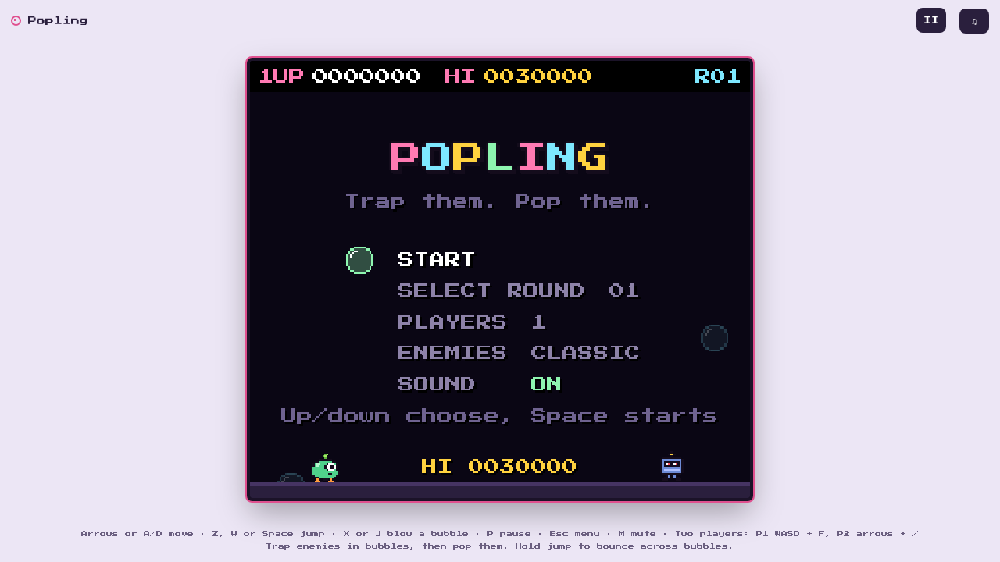

# Popling

**Trap them in bubbles, then pop them.** Popling is a single-screen arcade
platformer that runs in the browser. Blow bubbles, catch enemies inside them,
then burst them for fruit and points. It's one HTML file with no build step, no
backend and no tracking, and you can install it to your phone's home screen and
play offline.

<p align="center">
  
</p>

**▶ Play it at [olkham.github.io/Popling](https://olkham.github.io/Popling/)**
(after GitHub Pages is switched on, see
[Deploying to GitHub Pages](#deploying-to-github-pages))

---

## Contents

- [How to play](#how-to-play)
- [Controls](#controls)
- [Running it locally](#running-it-locally)
- [Deploying to GitHub Pages](#deploying-to-github-pages)
- [Project layout](#project-layout)
- [Updating](#updating)
- [Installing to the home screen](#installing-to-the-home-screen)
- [Licences](#licences)

## How to play

- **Blow a bubble** at an enemy to trap it. A trapped enemy floats away and
  breaks free after a while, angrier and faster than before.
- **Touch a bubble** to pop it. If an enemy is inside, it turns into fruit worth
  between 500 and 8,000 points.
- **Chain pops.** Popped bubbles set off the bubbles touching them. Each enemy
  after the first in a chain is worth a bigger bonus: 1,000, then 2,000, then
  4,000 and so on.
- **Bounce.** Hold jump while you land on a bubble to spring off it and reach
  higher platforms.
- **Element bubbles** sometimes drift in from the sides. Pop them to use them
  as weapons. Fire drops flames, lightning shoots bolts left and right, and
  water sweeps enemies away with it.
- **Power-ups** can appear from round 2: *Speed Up* (shoe), *Long Shot* (blue)
  and *Rapid Fire* (pink).
- **Don't hang around.** When a round runs long, *HURRY UP!* makes every enemy
  angry, and soon after that a ghost chases you that can't be bubbled.
- Every 70,000 points (100,000 later on) earns an **extra life**.

There are 30 hand-built rounds, then generated rounds up to 99. On the title
menu you can pick a starting round, choose 1 or 2 players, switch between the
*Classic* and *New* enemy sets, and turn sound on or off. The high score and
your last round are saved in the browser's `localStorage`.

## Controls

| Action        | Keyboard (1 player)    | Player 1 (2P) | Player 2 (2P)          | Gamepad            |
| ------------- | ---------------------- | ------------- | ---------------------- | ------------------ |
| Move          | ← → or A D             | A D           | ← →                    | Left stick / D-pad |
| Jump          | ↑, W, Z or Space       | W or Space    | ↑                      | A / Cross          |
| Blow a bubble | X, J, K or C           | F, G or Left Shift | /, ., L, Right Shift, Enter or Numpad 0 | X or B   |
| Pause         | P                      | P             | P                      | Start              |
| Menu          | Esc                    | Esc           | Esc                    |                    |
| Mute          | M                      | M             | M                      |                    |

On touch devices, on-screen **◀ ▶**, **JUMP** and **BUBBLE** buttons appear.
In landscape they sit either side of the screen.

## Running it locally

Popling is static files. You only need something that can serve a folder over
HTTP: Python (used by the scripts below), Docker, or any static server you
already have.

### With the scripts

```bash
# macOS / Linux
./install.sh          # finds python3 / python and asks which to use
./run.sh              # http://localhost:8000   (./run.sh 9000 for another port)
```

```bat
:: Windows
install.bat
run.bat
```

`install` is idempotent, so running it again keeps your earlier choice. Use
`--clean` (`./install.sh --clean` or `install.bat --clean`) to forget that
choice and choose again. `run` calls `install` first if you haven't run it yet.
No packages are installed and no virtualenv is created, because the game has
no dependencies.

### With Docker

```bash
docker compose up -d   # http://localhost:8080
docker compose down
```

This serves the game files read-only through `nginx:alpine`.

### Testing on a phone

`localhost` counts as a secure context, so the service worker and the install
button work there. Your laptop's LAN IP (`192.168.x.x`) does **not** count. To
try offline mode or home-screen install on a phone before you deploy, use an
HTTPS tunnel:

```bash
./run.sh
cloudflared tunnel --url http://localhost:8000
# or
ngrok http 8000
```

The game itself still plays over plain HTTP. Only the offline and install
features need HTTPS.

## Deploying to GitHub Pages

Every path in the site is relative (`./`), so it works unchanged from a project
subpath like `https://olkham.github.io/Popling/`.

1. Push to `main`.
2. In the repository, open **Settings → Pages**.
3. Under **Build and deployment**, set **Source** to *Deploy from a branch*,
   then choose **Branch** `main` and folder `/ (root)`, and click **Save**.
4. After a minute or so the site is live at
   `https://olkham.github.io/Popling/`. Tick **Enforce HTTPS** once the option
   becomes available.

The empty `.nojekyll` file tells Pages to serve the files as they are, without
running Jekyll. The helper scripts and `docker-compose.yml` get published too,
which is harmless.

For faster cache invalidation or an easier custom domain, **Cloudflare Pages**
and **Netlify** also work. Drag the folder into their dashboard.

## Project layout

```
index.html              the whole game: markup, styles and code in one file
manifest.webmanifest    home-screen install metadata (name, colours, icons)
sw.js                   service worker: offline cache
icons/                  favicon, Apple touch icon, PWA icons (normal + maskable)
fonts/                  self-hosted Press Start 2P (SIL OFL 1.1) and its licence
docs/                   README images
.nojekyll               tells GitHub Pages to serve the files as they are
install.sh / .bat       pick a Python for the local server (--clean to reset)
run.sh / .bat           serve the folder locally on port 8000
docker-compose.yml      serve with nginx on port 8080
```

All the sprites, levels, music and sound effects are generated in code inside
`index.html`. There are no image or audio files to load.

## Updating

The service worker serves the page network-first and fonts and icons
cache-first. A change to `index.html` goes live on the next load. If you change
anything in `fonts/` or `icons/`, **bump `CACHE` in `sw.js`** (for example to
`popling-v2`), or installed copies will keep showing the old files.

If you add a new file the game needs offline, add it to the `SHELL` list in
`sw.js` too.

## Installing to the home screen

- **Android / desktop Chrome or Edge:** use the install button in the top bar,
  or the browser's *Install app* option.
- **iOS:** Share → *Add to Home Screen*. The install button shows how. The game
  then opens full screen with no browser bars.

## Licences

The Press Start 2P font is © The Press Start 2P Project Authors and is used
under the SIL Open Font License 1.1. See `fonts/OFL-press-start-2p.txt` and
keep that file next to the font.
